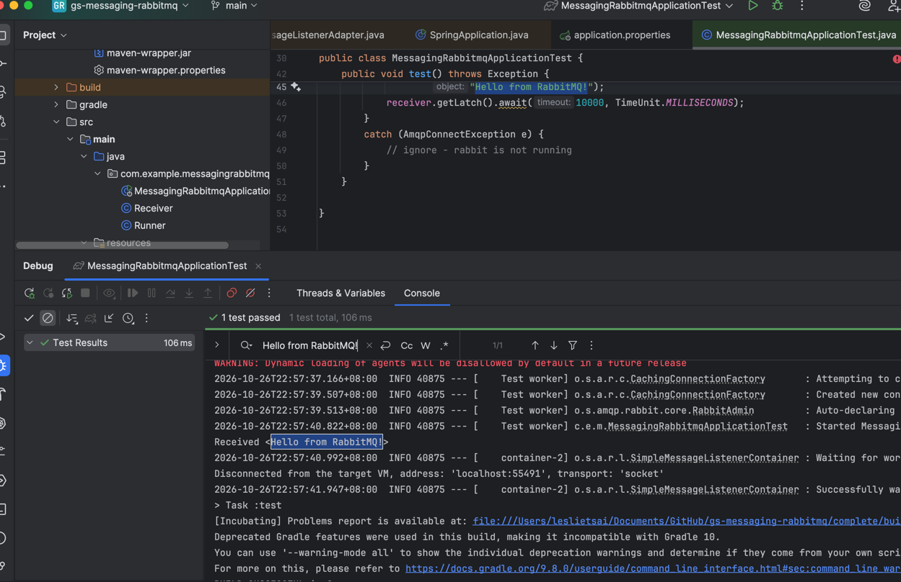

first commit

second commit
leslietsai@LesliedeMacBook-Pro jmeter % sh prepare-rabbitmq.sh
Declaring exchange...
Declaring queue...
Creating queue binding...
RabbitMQ exchange, queue, and binding are ready.
leslietsai@LesliedeMacBook-Pro jmeter % 
will try it this week
https://medium.com/@daisychepkemoi/load-testing-a-consumer-that-uses-rabbitmq-using-jmeter-c0a289118fce
